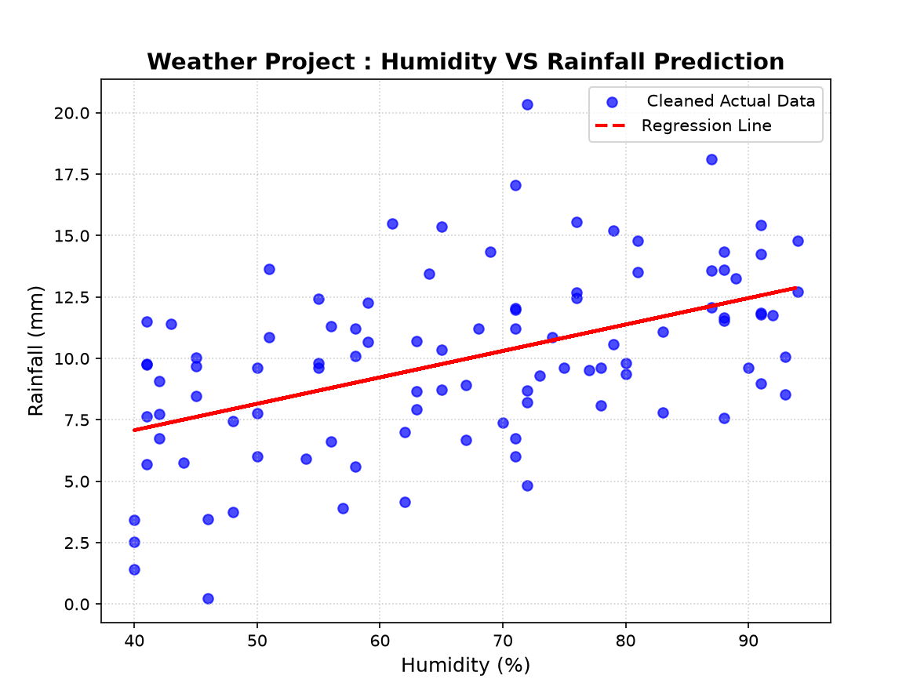

# 🌤️ Weather Analytics & Rainfall Prediction Pipeline

โปรเจกต์ Data Science แบบ End-to-End สำหรับวิเคราะห์และพยากรณ์ปริมาณน้ำฝน โดยครอบคลุมตั้งแต่การ **จำลองข้อมูล (Data Generation)**, **การทำความสะอาดข้อมูล (Data Cleaning)**, **การวิเคราะห์ทางสถิติ (Statistical Analysis)** ไปจนถึง **การสร้างโมเดลพยากรณ์ (Predictive Modeling)** ด้วยภาษา Python

---

## 🛠️ Tech Stack & Libraries
* **Language:** Python
* **Data Processing:** Pandas, NumPy
* **Statistical & Machine Learning:** SciPy (`scipy.stats.linregress`)
* **Visualization:** Matplotlib

---

## 📌 โครงสร้างและขั้นตอนการทำงาน (Project Pipeline)

### Phase 1: การสร้างข้อมูลดิบจำลอง (Raw Data Generation)
* จำลองข้อมูลสภาพอากาศ 100 วัน ประกอบด้วย อุณหภูมิ, ความชื้น, ความเร็วลม และปริมาณน้ำฝน
* จงใจใส่ปัญหาที่มักเจอในข้อมูลจริงเพื่อทดสอบการคลีนข้อมูล:
  * **ค่าว่าง (NaN)** ในบางคอลัมน์
  * **ข้อมูลผิดปกติ (Outliers)** เช่น ปริมาณน้ำฝนติดลบ (`-25.0` มม.) หรือค่าสูงเกินจริง (`999.0` มม.)
* บันทึกข้อมูลดิบออกเป็นไฟล์ `raw_weather_data.csv`

### Phase 2: การทำความสะอาดข้อมูล (Data Cleaning)
* จัดการค่าว่าง (Missing Values) ด้วยการแทนที่ด้วยค่าเฉลี่ย (Mean Imputation)
* กรองข้อมูลผิดปกติ (Outliers) ออก โดยกำหนดช่วงปริมาณน้ำฝนที่สมเหตุสมผล (0 ถึง 50 มม.)
* ปัดเศษทศนิยมให้เหลือ 2 ตำแหน่ง เพื่อความสวยงามและเป็นระเบียบ
* บันทึกข้อมูลที่สะอาดแล้วลงไฟล์ `clean_weather_data.csv`

### Phase 3 & 4: การวิเคราะห์ทางสถิติและการพยากรณ์ (Analysis & Modeling)
* **Correlation Check:** คำนวณหาค่าความสัมพันธ์ (Pearson Correlation) ระหว่างความชื้นและปริมาณน้ำฝน
* **Linear Regression:** สร้างสมการเส้นตรงสำหรับทำนายผลลัพธ์จากสถิติด้วย SciPy
* **Prediction Test:** ทดลองนำค่าความชื้นใหม่มาป้อนเข้าโมเดลเพื่อพยากรณ์ปริมาณน้ำฝนที่จะเกิดขึ้น
* **Visualization:** แสดงผลข้อมูลด้วย Scatter Plot พร้อมวาดเส้นแนวโน้ม (Regression Line)

---

## 📊 ผลลัพธ์และการแสดงผล (Model Output)



---

## 🚀 วิธีการรันโค้ด (How to Run)
1. ดาวน์โหลดหรือ Clone คลังเก็บงาน:
   ```bash
   git clone [https://github.com/johnnaratip/weather-ml.git](https://github.com/johnnaratip/weather-ml.git)# weather-ml
